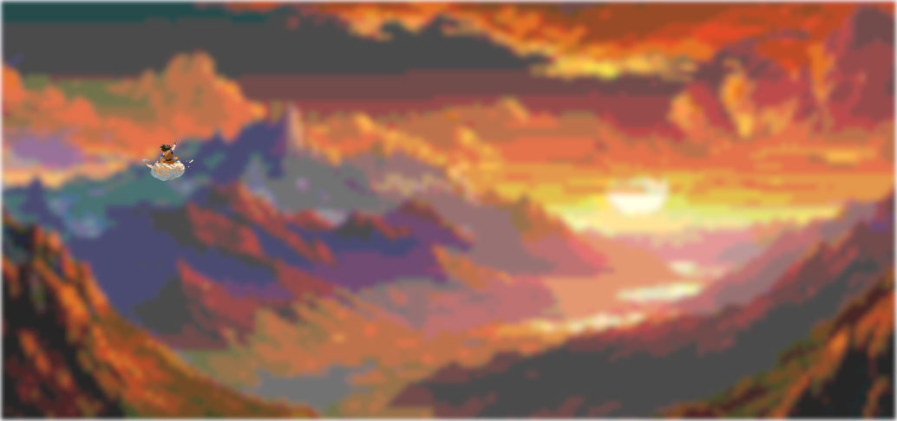
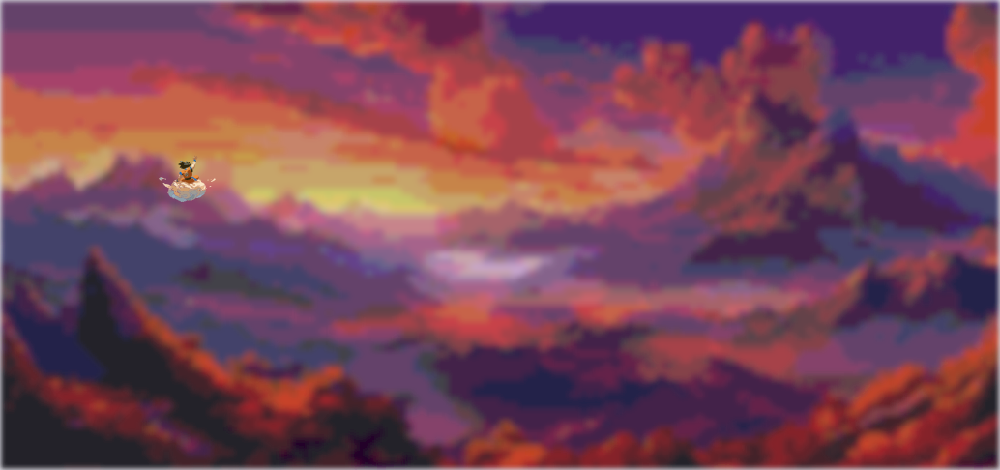
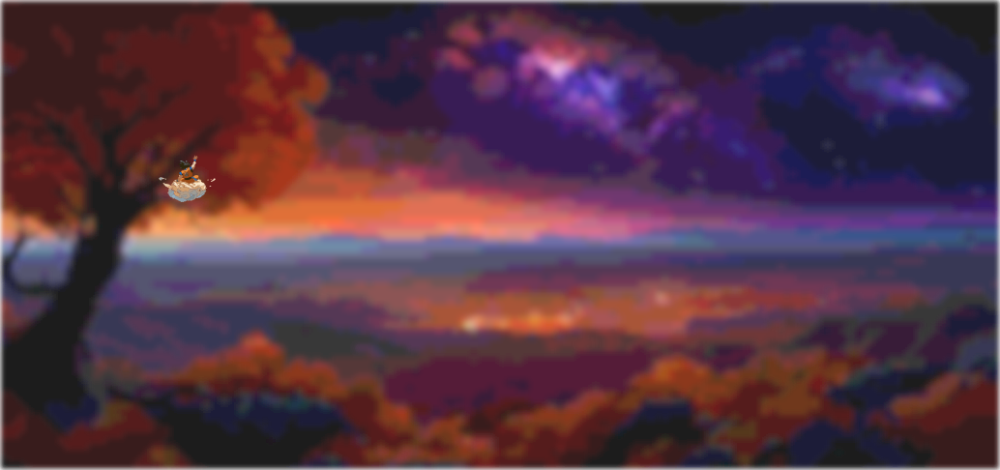

# Kinto Mode

A Dragon Ball–themed mod for Claude: orange palette (light by day, dark by night), a painted mountain backdrop and Goku riding the Flying Nimbus in the distance. It is more than a skin: the mod tracks your session's **power level**, collects **Dragon Balls** from your task list, and summons **Shenron** when you collect all seven.

> Power level of this package: over 9000. Install time: a few seconds.



*Preview of the backdrop layers (static render of the mod's own scene; in the app Goku and the extras are animated).*

## What you get

| Feature | How it works |
| --- | --- |
| **Colour theme** | Orange, cream and brown palette in light and dark mode. Accent `#F57C00`, with blue `#1F4E9E` as a secondary colour. |
| **Mountain backdrop** | Orange sky and mountains from an image generated in ComfyUI, embedded as SVG. Panels are blurred over it so text stays readable. |
| **Flying Goku** | Idle: he hovers in the distance. While Claude works he takes off, crosses the scene, returns from the left and brakes at home. |
| **Kamehameha** | When a turn finishes, Goku fires a one-off flash. |
| **Power level** | A bar above the prompt shows the session's context usage as a percentage, the same as the app's context panel (relative to the compaction window). At 25, 50, 75 and 90% there is a sound and a toast, and the bar flashes. Above 90% it adds "over 9000!". The value is also in the status line. |
| **Super Saiyan** | From 50% context usage the bar turns gold ("SUPER SAIYAN"), a golden aura pulses around Goku and the whole backdrop glows. A toast announces it. |
| **Dragon Balls** | Each completed step of the task list summons a yellow-orange ball with red stars (1–7) that hovers around the chat, alternating left and right. There are always seven, spread evenly across the steps (3 steps give 2, 2 and 3 balls). When the list is complete the balls turn white, flash and vanish, and Shenron appears. |
| **Shenron** | After all tasks are done a green dragon flies once across the sky (about 45 seconds). It is untangled into a sine wave: the body is a smooth ribbon animated frame by frame in CSS, with the head (vectorised from a ComfyUI image) nodding along. It then disappears until you collect the balls again. |
| **Three backdrops** | Sunset (6–19 h), dusk with a purple sky (19–22 h) and a starry night (22–6 h). `auto` picks by time of day; force one with `/tlo-kinto`. |
| **Stars** | At dusk and night, small stars twinkle in the clear sky, each at its own rhythm. |
| **Tool call captions** | Under a tool call: "charging ki…" while running, "hit landed" on success, "attack failed" on error. |
| **Sounds and toasts per event** | Configurable in a single table (see below), in English or Polish. |

### Backdrops

| Sunset | Dusk | Night |
| --- | --- | --- |
|  |  |  |

> In-app texts (toasts, captions, the power bar, command replies) come in English and Polish: see [Language](#language). Command arguments stay Polish (`zachod`, `zmierzch`, `noc`, `progi`, `styl`, `blysk`), with English aliases (`sunset`, `dusk`, `night`, `thresholds`, `style`, `flash`).

## Installation

The mod is a one-plugin marketplace. In a Claude Code session:

```
/plugin install goku --marketplace wziom/kinto-mode
```

Confirm adding the marketplace (`y`) and choose the install scope. The full name is `goku@kinto-mode`: the plugin is called `goku`, the marketplace `kinto-mode`.

### Trying it from a local folder

Clone the repository, then:

```bash
claude plugin marketplace add <path-to-clone>
claude plugin install goku@kinto-mode
```

After editing files, reload the mod in a session with `/reload-plugins`.

Developer mode, no installation (one session only):

```bash
claude --plugin-dir <path-to-clone>
```

### Phone

The mod runs on the computer and the mobile app draws the theme it sends. Open a session hosted by a computer with the mod installed (for example through Remote Control). On a narrow screen the backdrop is cropped to the centre, so Goku may fall out of frame. Not tested on a real phone.

## Commands

Commands end in `-kinto` so they do not clash with other plugins' commands.

| Command | Effect |
| --- | --- |
| `/aura-kinto` | Toggles continuous flight: Goku flies all the time, not only while Claude works. |
| `/aura-kinto styl` | Toggles a light Dragon Ball style in replies. Answers stay factual, with an occasional short reference such as a task's "power level". Off by default. |
| `/tlo-kinto` | Shows the current backdrop. `/tlo-kinto zachod` (sunset), `zmierzch` (dusk) or `noc` (night) forces one, `/tlo-kinto auto` returns to time-of-day selection. The current session remembers the choice. |
| `/moc-kinto` | Shows the power level and the current thresholds. |
| `/moc-kinto progi 20 40 60 80` | Sets the four power-level thresholds (increasing, 1–100) for the current session. |
| `/moc-kinto ssj 40` | Sets the context usage at which Super Saiyan starts, for the current session. |
| `/moc-kinto reset` | Returns the thresholds to the plugin settings. |
| `/moc-kinto ssj`, `/moc-kinto blysk` | Tests: toggles a Super Saiyan preview, triggers the power-up bar flash, so you can see them without waiting. |

### Power thresholds

The defaults are 25, 50, 75 and 90% for the four power levels and 50% for Super Saiyan. To change them permanently, edit the plugin's options (`prog1`–`prog4` and `progSsj`, shown when you install the plugin and in its settings). The commands above override them until the session ends.
| `/lang-kinto pl` / `en` | Switches the language of in-app texts for the current session. |
| `/shenron-kinto` | Summons Shenron without collecting balls (for testing). `/shenron-kinto stop` sends him away. |

## Event configuration

Sounds are set in the `EVENTY` table at the top of [`hooks/register.tsx`](hooks/register.tsx); notification texts live in the `TXT` table below it, one set per language:

```ts
const EVENTY: Record<string, Reakcja> = {
  start:   { dzwiek: 'sounds/start.wav' },
  koniec:  { dzwiek: 'sounds/koniec.wav' },
  poziom:  { dzwiek: 'sounds/poziom.wav' },
  kompakt: { dzwiek: 'sounds/kompakt.wav' },
  kula:    { dzwiek: 'sounds/kula.wav' },
  shenron: { dzwiek: 'sounds/shenron.wav' },
}
```

- `dzwiek` (sound): path to a file in `sounds/`. An empty string or a missing key means silence.
- `TXT.<lang>.toast.<event>`: notification text. `{n}` is replaced by the power level or the number of collected balls. An empty string means no toast.
- Events: `start` (turn begins), `koniec` (turn ends), `poziom` (new power threshold), `kompakt` (context compaction), `kula` (task step completed), `shenron` (whole list completed).

## Language

In-app texts are available in English (default) and Polish. Set the `language` option in the plugin settings for a permanent choice, or run `/lang-kinto pl` or `/lang-kinto en` to switch for the current session.

All sounds were generated locally in ComfyUI (effects: Stable Audio Open, Shenron theme: ACE-Step 1.5) and lightly processed (filter, saturation, short reverb). They use nobody's recordings. Stable Audio Open has its own licence (Stability AI Community License): commercial use requires registration with Stability AI above the revenue thresholds it sets.

## How Goku flies

1. Claude is not working: Goku hangs in the distance and floats lazily.
2. Claude is working (turn start to turn end): Goku takes off, speeds right, exits the edge, returns from the left and brakes.
3. End of turn: a one-off Kamehameha flash.
4. `/aura-kinto`: continuous flight.
5. All Dragon Balls collected: Shenron flows through the background.
6. System-level reduced motion: everything stands still.

Goku does not follow the cursor. The scene runs no scripts, so all motion is pure CSS.

## Known limitations

- **Sound:** according to the documentation the engine plays clips through the system player available on macOS. On Windows and Linux sounds may not play. Toasts always work.
- **One scene at a time:** a theme accepts one scene, so the mod swaps it when the time of day changes or after `/tlo-kinto`. It refreshes at the next backdrop repaint.
- **Scene size limit:** the backdrop SVG may be 131,072 characters. The mosaic (176×84 cells), Goku and extras take about 125k on each of the three scenes, so there is little headroom.
- **Dragon Balls:** counted from calls to the task-list tool (`mcp__ccd_turn__update_plan`) in the desktop app. In other clients the list may look different and the balls will not light up.
- **Backdrop resolution:** it is a mosaic with light blur, so it looks painterly, not photographic.

## Structure

```
.claude-plugin/plugin.json        plugin manifest
.claude-plugin/marketplace.json   one-plugin marketplace
hooks/register.tsx                all the logic: colours, scene, events, bar
hooks/make-colors.js              theme generator (from the plugin tools)
hooks/tlo-svg.ts                  day backdrop (sunset) as an SVG mosaic
hooks/tlo-noc-svg.ts              dusk backdrop as an SVG mosaic
hooks/tlo-gwiazdy-svg.ts          starry night backdrop as an SVG mosaic
hooks/goku-svg.ts                 Goku on the Flying Nimbus as a vector outline
hooks/ssj-wlosy-svg.ts            Super Saiyan hair (ComfyUI image, vectorised)
hooks/shenron-svg.ts              Shenron's head as a vector outline (the body is drawn by register.tsx)
sounds/                           short event sounds
docs/                             preview images used in this README
types/index.d.ts                  plugin state contract
```

## Development

Validate the plugin:

```bash
claude plugin validate .
```

`hooks/tlo-svg.ts` and `hooks/goku-svg.ts` are generated from images. If you replace the artwork, keep the total scene size under the limit from the limitations section.

## Licence

MIT. Dragon Ball belongs to its creators. This is a fan theme with no official artwork or sounds.
